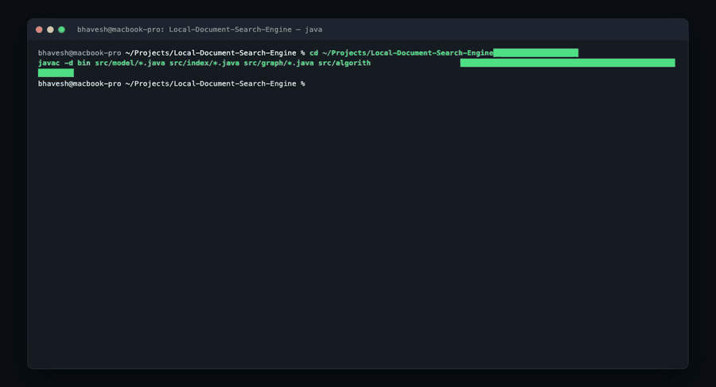
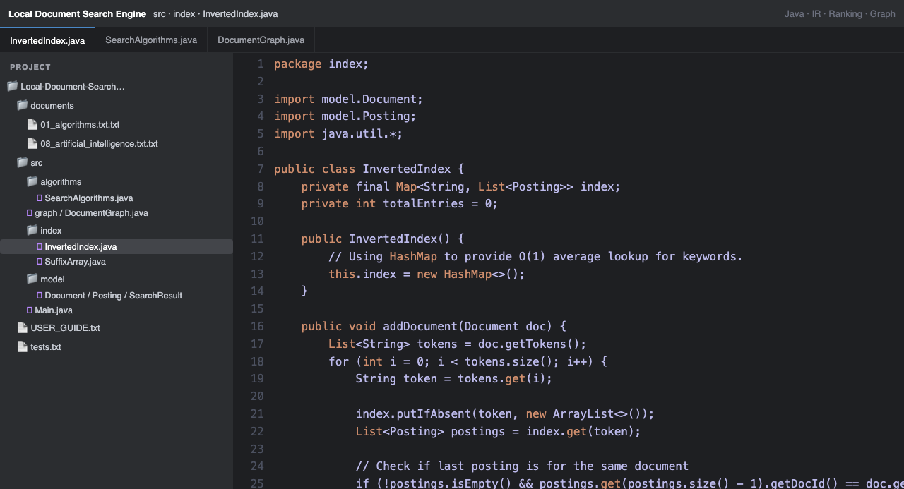

<div align="center">

# 🔍 Local Document Search Engine

**A first-year Java project — a local search engine that indexes `.txt` documents in memory and provides keyword search, exact phrase matching, related-document paths (Dijkstra) and ranking. Every algorithm is written from scratch: no external search libraries.**


</div>

---

## 🎬 Demo (31 seconds — real run)



> 📥 Watch the full video: [`demo/search-engine-demo.mp4`](demo/search-engine-demo.mp4)

---

## 🖼️ The project in IntelliJ IDEA



---

## ✨ What it does

| Menu option | Feature | Algorithm / structure |
|---|---|---|
| **1. Search keyword** | Rank documents by term frequency | **Inverted index** → `HashMap` postings, O(1) average lookup |
| **2. Search exact phrase** | Find the exact, contiguous phrase with a **context snippet** | **Candidate filtering** via the inverted index, then **KMP** (O(N+M)) and a **Suffix Array** (O(M log N)) for hot documents |
| **3. Find conceptual path** | Shortest conceptual route between two documents | **Document graph** + **Dijkstra's SSSP** over similarity edges |
| **4. Document information** | Metadata, terms and stats of one document | Model classes (`Document`, `Posting`, `SearchResult`) |
| **5. Index statistics** | Documents, unique terms, graph nodes/edges | Live in-memory counters |
| **6. Suffix Array status** | Which documents have a materialized suffix array | Lazy per-document construction |
| **7. Graph statistics** | Nodes, edges, connectivity of the document graph | Adjacency structure |

Demo corpus: 8 computer-science text files in `documents/` — 160 unique terms, 38 similarity edges.

## 🧠 How a search flows

1. **Load & normalize** — every document is read, lowercased and stripped of punctuation at startup
2. **Index** — each term gets a postings list: `term → [(docId, frequency), ...]`
3. **Keyword query** — one hash lookup, results sorted by frequency
4. **Phrase query** — *candidate filtering* first (only docs containing **all** words), then an exact KMP scan inside the candidates, then a snippet is extracted around the match
5. **Hot document optimization** — a document's **suffix array is built lazily** after repeated phrase accesses, upgrading later searches from O(N+M) to O(M log N)
6. **Conceptual path** — documents are graph nodes connected by similarity edges; Dijkstra finds the shortest reading path between two topics

## 😅 Challenges I faced & how I overcame them

**1. "Algorithm" found nothing when the document said "Algorithm".**
My first keyword search was case-sensitive and punctuation-sensitive — `Algorithm,` didn't match `algorithm`.
**Fix:** a normalization step at indexing time (lowercase, strip punctuation) and the same normalization on every query. One rule, applied on both sides.

**2. Multi-word queries in the keyword box crashed the ranking.**
The inverted index maps *single* terms — a "machine learning" keyword query looked up a term that simply doesn't exist.
**Fix:** detect multi-word input and route it to the exact-phrase engine; keep keyword search strictly single-term (the menu now tells the user which option to use).

**3. Exact phrase search was scanning every document.**
Running KMP over all 8 full documents for every phrase was wasteful — most documents can't possibly contain the phrase.
**Fix:** **candidate filtering** — use the inverted index first to keep only documents containing *all* the phrase words, then run KMP only inside those candidates.

**4. Stop-word queries returned confusing empty results.**
Searching just `the` or `of` produced results that made no sense, and queries like `!!!` produced an empty crash-y output.
**Fix:** a **stop-word set** (`STOP_WORDS` in `SearchAlgorithms`) filters tokens during normalization, and if nothing remains the engine prints a clear *"Query only contains stop words or punctuation"* message instead of pretending to search.

**5. Building suffix arrays for every document ate memory for nothing.**
Suffix arrays are powerful but heavy — and most documents never get a phrase search.
**Fix:** **lazy construction**. The engine counts phrase-search accesses per document (`phraseSearchCounts`) and only materializes a suffix array after a document is actually used repeatedly (`SUFFIX_ARRAY_THRESHOLD`). Cold documents keep using plain KMP.

**6. Snippets were cut mid-word and unreadable.**
The first snippet logic grabbed a fixed character window around the match, chopping words in half.
**Fix:** `extractSnippet` expands the match position outward to word boundaries (~20 words) so every snippet reads like a sentence.

**7. "Related documents" was just my opinion.**
I wanted conceptual paths between topics, but similarity without structure is just a feeling.
**Fix:** modeled documents as a **weighted graph** (similarity between docs as edge weights, computed at startup — 38 edges over 8 docs) and used **Dijkstra's shortest-path** to answer "how do I get from Data Structures to Information Retrieval?" — the demo literally shows `06_machine_learning → 08_artificial_intelligence → 07_information_retrieval` with total distance 0.86.

## 📖 What I learned

- How a real search engine works: **inverted index → postings → ranking**, the same core idea as web search engines
- **Classic string algorithms** — KMP's failure function and why suffix arrays beat repeated scans for repeated queries
- **Dijkstra's algorithm** on a real problem (not just a textbook graph)
- **Lazy evaluation** — building expensive structures only when usage justifies them
- **Complexity analysis in practice** — O(1) hash lookups vs O(N+M) vs O(M log N), and when each wins
- **Preprocessing beats cleverness** — normalizing text once at index time is cheaper than handling messy input at query time

## 🚀 How to run

### In IntelliJ IDEA
1. Clone the repo and open the folder in IntelliJ (**File → Open**)
2. Run `src/Main.java` ▶️ (the `documents/` folder must sit next to the project root)

### From the terminal
```bash
git clone https://github.com/0xbhavesh404dev/Local-Document-Search-Engine-with-Ranking-and-suggestions23.git
cd Local-Document-Search-Engine-with-Ranking-and-suggestions23
javac -d bin src/model/*.java src/index/*.java src/graph/*.java src/algorithms/*.java src/*.java
java -cp bin Main
```

Try the demo session from [`USER_GUIDE.txt`](USER_GUIDE.txt): keyword `algorithm` → phrase `machine learning` → conceptual path `2 → 7`.

## 📁 Project structure

```
├── src/
│   ├── Main.java                     # menu, document loading, query routing
│   ├── algorithms/SearchAlgorithms.java   # KMP, stop words, snippet extraction
│   ├── index/InvertedIndex.java      # term → postings map
│   ├── index/SuffixArray.java        # exact phrase matching (lazy)
│   ├── graph/DocumentGraph.java      # similarity graph + Dijkstra
│   ├── model/Document.java · Posting.java · SearchResult.java
│   └── Project_Architecture.txt
├── documents/                        # the demo corpus (8 CS topics)
├── tests.txt                         # test queries
├── USER_GUIDE.txt                    # demo walkthrough
├── demo/ + screenshots/              # demo video & IDE screenshot
```

---

<div align="center">

**A 1st-year algorithms & data structures project** — everything implemented from scratch, no search libraries.

</div>
